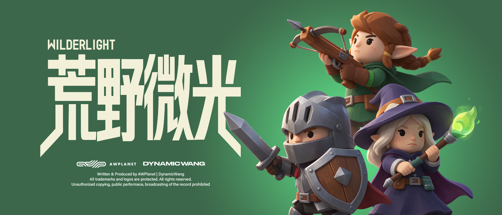
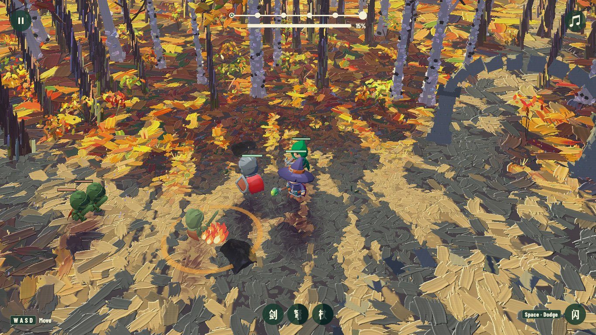
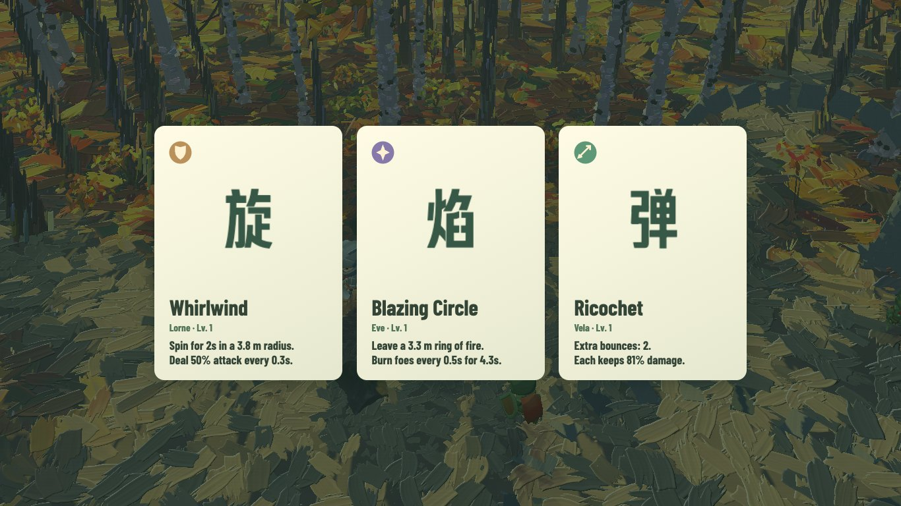

# Wilderlight · 荒野微光

**Game design and production by DynamicWang**　｜　[简体中文](README.md)

## About This Game

By the time Vela’s first bolt crosses the clearing, Lorne has his sword out. Close the distance and he can catch the front rank in a single sweep. Or lead the party around the tree line, let the pursuers bunch up, and give Eve a perfect shot with a fireball.

Wilderlight is a single-player action roguelite about leading three adventurers through two chapters of woodland, from late sunlight into moonrise. Each hero picks a target and attacks on their own. You steer the party, time each dodge, and decide who gets the next blessing.

### Into the Sunward Woods

The early waves give you room to find your footing. The clearing feels a good deal smaller when the goblin officer draws his blade. Once enraged, he charges three times in a row. As the first charge goes wide, watch the ground to see where the next one will take him.

Bring him down and the gold drains from the canopy. Fireflies rise in the Moonlit Woods, where skeleton mages can reach you from across the clearing. Survive five waves and the skeleton lord takes the field. At half health, he can pick a fresh landing spot for each leap, then chase the party with his blade still spinning.



### Three Heroes, One Dodge

**Lorne**, the warden, can catch several enemies within reach of his sword. **Vela**, the ranger, opens fire well before they reach him. **Eve**, the ember mage, leaves enemies burning even after her fireball bursts. A few steps forward can line up a beautiful swing for Lorne and put Eve within reach of an enemy blade. Hit Space and all three dodge in the direction you choose.

### Take a Blessing. Change Your Route.

The first three blessings give you a feel for how differently a run can play. With **Whirlwind**, skim the edge of a crowd to keep enemies within Lorne’s reach for one more turn of the blade. With **Ricochet**, a pair of enemies standing close together makes a fine target for Vela. Take **Blazing Circle** and it pays to double back, drawing pursuers through Eve’s fire a second time.



Later choices include piercing blade waves, volleys of bolts, and flames that leap between enemies. Each skill and blessing can reach level 12. Finish both chapters to put a time on your local leaderboard. On the next run, try a different build and see how much sooner you can make it home.

### Play Locally

Download and extract the repository ZIP, or clone the repository. From the game directory, run the following command with Python 3.7 or later. Use a browser with WebGL 2 support.

```sh
python3 start.py
```

On Windows, run `py -3 start.py`. On macOS, you can also double-click `启动游戏.command`. The launcher opens [the local game](http://127.0.0.1:8000/). If that port is busy, use `python3 start.py --port 8001`. The repository includes the game’s dependencies and demo assets, so you can play offline after downloading.

| Action | Keyboard and mouse | Touch |
| --- | --- | --- |
| Move the party | WASD, arrow keys, or click the ground | Drag the left stick or tap the ground |
| Dodge | Space | Tap the boot while steering |
| Pause or resume | Esc or the pause button | Tap pause, then Resume |
| Switch between Chinese and English | Language button in the main menu | Same |

### Inside the Project

- `app.js` handles menus, input and local rankings. The leaderboard keeps the fastest 100 completed runs in this browser and displays the top ten.
- `src/simulation.js`, `src/combat-rules.js` and `src/boss-rules.js` handle combat. Skill progression lives in `src/progression.js`.
- The forest renderer lives in `src/original-world.js`, with scene coordination in `src/scene.js`. Run `node tools/render-music.mjs` to regenerate the public build’s day and night demo tracks.
- The Chinese interface uses Xianglifang Heiti when installed and falls back to a system font.

### Credits and Licenses

**DynamicWang** designed and produced Wilderlight. The game code is available under the [MIT License](LICENSE). AWPlanet / DynamicWang reserve the rights to the promotional banner and its brand marks.

The public build includes CC0 character, skeleton and weapon models by Kay Lousberg (KayKit), and CC0 mossy rock models by Kless Gyzen via Poly Haven. The daytime enemies use knight and ranger models to demonstrate the goblin encounters. Rendering, audio, font and asset credits are listed in the [third-party notices](THIRD_PARTY.md).
