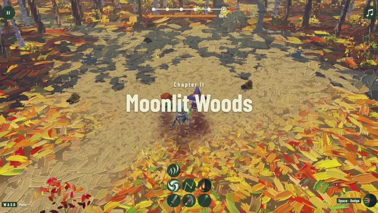

# Wilderlight · 荒野微光

**[Play in your browser](https://awplanets.github.io/Wilderlight/play/1f63bea/)**

**Game design and production by DynamicWang**　｜　[简体中文](README.md)

## About This Game

Wilderlight is a single-player action roguelite. Lorne carries a sword, Vela a crossbow, and Eve a staff. Each fights on their own while you steer all three. Press Space and the whole party dodges together.


### Night falls on the same clearing

When you enter the Sunward Woods, birch shadows stretch across a path strewn with gold and rust-red leaves. At the end of the first chapter, the camera stays put. The path you just crossed slowly turns blue. Strips of moonlight reach through the branches, and a few fireflies blink low over the leaves.

[](docs/moonrise.mp4)

[Watch the day-to-night clip in 1080p](docs/moonrise.mp4)

### Three blessings. Pick one.

Whirlwind for Lorne, Blazing Circle for Eve, or Ricochet for Vela? Only one of those cards goes with you. If a blessing turns up again, you can take it all the way to level 12. A second trip with the same three heroes can leave you with a very different set of skills.


### Coming next week

More maps and stages are coming to Wilderlight the week of November 30.

## Play Locally

Download and extract the repository ZIP, or clone the repository. From the game directory, run the following command with Python 3.7 or later. Use a browser with WebGL 2 support.

```sh
python3 start.py
```

On Windows, run `py -3 start.py`. On macOS, you can also double-click `启动游戏.command`. The launcher opens [the local game](http://127.0.0.1:8000/). If that port is busy, use `python3 start.py --port 8001`. The repository includes the game’s dependencies and demo assets, so you can play offline after downloading.

| Action | Keyboard and mouse | Touch |
| --- | --- | --- |
| Move the party | WASD, arrow keys, or click the ground | Drag the left stick or tap the ground |
| Dodge | Space | Tap the boot while steering |
| Pause or resume | Esc or the pause button | Tap pause, then Resume |
| Switch between Chinese and English | Language button in the main menu | Same |

### Inside the Project

- `app.js` handles menus, input and local rankings. The leaderboard keeps the fastest 100 completed runs in this browser and displays the top ten.
- `src/simulation.js`, `src/combat-rules.js` and `src/boss-rules.js` handle combat. Skill progression lives in `src/progression.js`.
- The forest renderer lives in `src/original-world.js`, with scene coordination in `src/scene.js`. Run `node tools/render-music.mjs` to regenerate the public build’s day and night demo tracks.
- The Chinese interface uses Xianglifang Heiti when installed and falls back to a system font.

### Credits and Licenses

**DynamicWang** designed and produced Wilderlight. The game code is available under the [MIT License](LICENSE). The banner, screenshots and gameplay clip are supplied by the author. AWPlanet / DynamicWang reserve the rights to their original artwork and brand marks shown here.

The public build includes CC0 character, skeleton and weapon models by Kay Lousberg (KayKit), and CC0 mossy rock models by Kless Gyzen via Poly Haven. Some character models in the public build differ from those in the footage. Rendering, audio, font and asset credits are listed in the [third-party notices](THIRD_PARTY.md).
