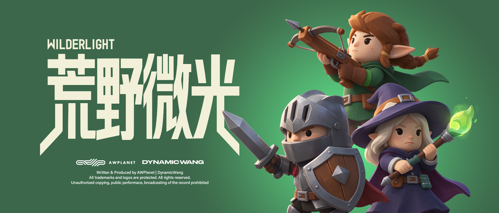
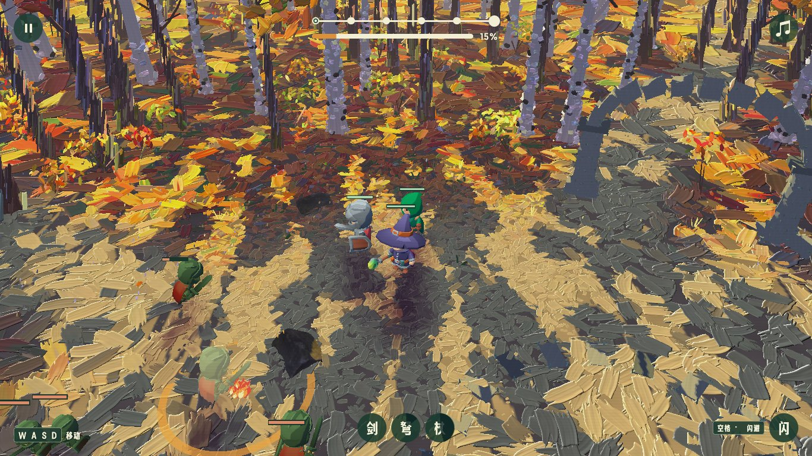
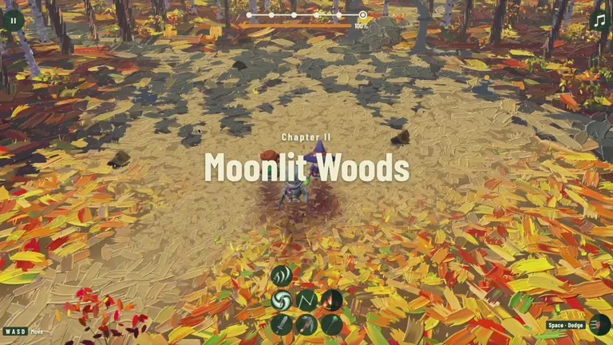
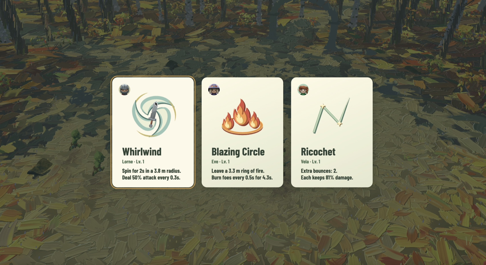

# 荒野微光 · Wilderlight

**DynamicWang** · [中文介绍](#关于这款游戏) · [English](#about-this-game)

## 关于这款游戏

《荒野微光》是一款单人动作肉鸽。洛恩提剑，薇拉端弩，伊芙举起法杖。



### 天黑以后，还是这片林子

走进逐日之森时，白桦的影子横在小路上，脚下的落叶一层金黄，一层锈红。第一章结束，镜头留在原地。你刚走过的那条路渐渐泛蓝，月光从树缝里斜照下来。最暗的树影底下，几只萤火虫贴着地面一明一灭。

[](docs/moonrise.mp4)

[观看昼夜交替实录（1080p）](docs/moonrise.mp4)

### 三张祝福，只能带走一张

旋风斩击、燎原火阵、弹射箭矢同时摆在面前，你想先看谁学会新招？往后再遇到同一张祝福，还可以接着升，最高到 12 级。哪怕带着同样的三个人进林子，两趟走下来，手里的招式也会很不一样。



### 下周更新

11 月 30 日这一周，《荒野微光》将加入更多地图和关卡。

---

## About This Game

Wilderlight is a single-player action roguelite. Lorne carries a sword, Vela a crossbow, and Eve a staff. 


### Night falls on the same clearing

When you enter the Sunward Woods, birch shadows stretch across a path strewn with gold and rust-red leaves. At the end of the first chapter, the camera stays put. The path you just crossed slowly turns blue. Strips of moonlight reach through the branches, and a few fireflies blink low over the leaves.

[](docs/moonrise.mp4)

[Watch the day-to-night clip in 1080p](docs/moonrise.mp4)

### Three blessings. Pick one.

Whirlwind for Lorne, Blazing Circle for Eve, or Ricochet for Vela? Only one of those cards goes with you. If a blessing turns up again, you can take it all the way to level 12. A second trip with the same three heroes can leave you with a very different set of skills.


### Coming next week

More maps and stages are coming to Wilderlight the week of November 30.

---

## 在本机开始

下载并解压仓库 ZIP，或克隆本仓库。在游戏目录运行以下命令，需要 Python 3.7 或更高版本和支持 WebGL 2 的浏览器。

```sh
python3 start.py
```

macOS 也可以双击「启动游戏.command」。Windows 可运行 `py -3 start.py`。浏览器会打开 [本地游戏](http://127.0.0.1:8000/)。端口已被占用时，可运行 `python3 start.py --port 8001`。游戏依赖和演示资源都在仓库内，下载后可以离线游玩。

| 操作 | 键鼠 | 触屏 |
| --- | --- | --- |
| 移动小队 | WASD、方向键或点击地面 | 拖动左侧摇杆或点地面 |
| 向当前方向闪避 | 空格 | 点靴子按钮，可与摇杆同时使用 |
| 暂停与继续 | Esc 或点击暂停按钮 | 点暂停按钮，再选「继续游戏」 |
| 切换中英文 | 主菜单右上角的语言按钮 | 同左 |

### 开发入口

- 菜单、输入和本机排行榜在 `app.js`。
- 战斗模拟与首领招式在 `src/simulation.js`、`src/combat-rules.js` 和 `src/boss-rules.js`。技能成长数值在 `src/progression.js`。
- 林地渲染在 `src/original-world.js`，场景调度在 `src/scene.js`。公开版使用演示配乐，可用 `node tools/render-music.mjs` 重新生成昼夜两首曲子。
- 中文界面优先使用设备已安装的乡立方黑体，也可使用系统回退字体。

### 作者与素材

游戏设计与制作归 **DynamicWang** 署名，游戏代码以 MIT 许可证发布。介绍页使用作者提供的宣传头图、截图与实录。AWPlanet / DynamicWang 保留其中自制美术和品牌标志的权利。[代码许可证](LICENSE)

公开版使用 Kay Lousberg（KayKit）的角色、骷髅和武器模型，以及 Kless Gyzen 在 Poly Haven 发布的苔石模型，均采用 CC0。公开版部分角色采用替代模型，与实录中的造型略有不同。渲染基础、音效、字体及各项素材的作者和许可见[第三方素材清单](THIRD_PARTY.md)。

## Play Locally

Download and extract the repository ZIP, or clone the repository. From the game directory, run the following command with Python 3.7 or later. Use a browser with WebGL 2 support.

```sh
python3 start.py
```

On Windows, run `py -3 start.py`. On macOS, you can also double-click `启动游戏.command`. The launcher opens [the local game](http://127.0.0.1:8000/). If that port is busy, use `python3 start.py --port 8001`. The repository includes the game’s dependencies and demo assets, so you can play offline after downloading.

| Action | Keyboard and mouse | Touch |
| --- | --- | --- |
| Move the party | WASD, arrow keys, or click the ground | Drag the left stick or tap the ground |
| Dodge | Space | Tap the boot while steering |
| Pause or resume | Esc or the pause button | Tap pause, then Resume |
| Switch between Chinese and English | Language button in the main menu | Same |

### Inside the Project

- `app.js` handles menus, input and local rankings. The leaderboard keeps the fastest 100 completed runs in this browser and displays the top ten.
- `src/simulation.js`, `src/combat-rules.js` and `src/boss-rules.js` handle combat. Skill progression lives in `src/progression.js`.
- The forest renderer lives in `src/original-world.js`, with scene coordination in `src/scene.js`. Run `node tools/render-music.mjs` to regenerate the public build’s day and night demo tracks.
- The Chinese interface uses Xianglifang Heiti when installed and falls back to a system font.

### Credits and Licenses

**DynamicWang** designed and produced Wilderlight. The game code is available under the [MIT License](LICENSE). The banner, screenshots and gameplay clip are supplied by the author. AWPlanet / DynamicWang reserve the rights to their original artwork and brand marks shown here.

The public build includes CC0 character, skeleton and weapon models by Kay Lousberg (KayKit), and CC0 mossy rock models by Kless Gyzen via Poly Haven. Some character models in the public build differ from those in the footage. Rendering, audio, font and asset credits are listed in the [third-party notices](THIRD_PARTY.md).
